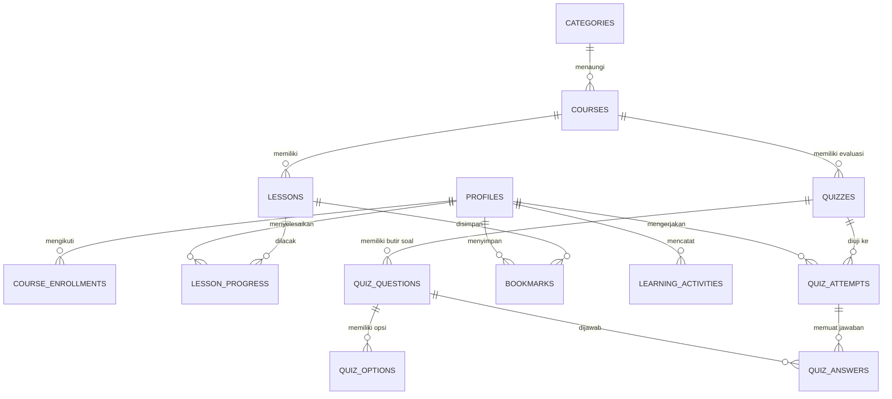

# SKILLFORGE — PANDUAN AKADEMIK & DOKUMENTASI PORTFOLIO SKRIPSI
### *Interactive Informatics Learning Platform untuk Pendidikan Informatika*

---

## 1. Identitas & Gambaran Umum Produk

* **Nama Produk**: SkillForge
* **Tagline**: *Learn Informatics. Build Your Future.*
* **Fokus Bidang**: Program Studi Pendidikan Informatika / Teknik Informatika.
* **Tujuan**: Platform pembelajaran digital interaktif yang dirancang khusus untuk memenuhi standar capaian pembelajaran lulusan (CPL) calon sarjana pendidikan informatika, mencakup aspek penguasaan materi teknis komputasi, metodologi pedagogi digital, dan evaluasi asesmen terverifikasi.

---

## 2. Arsitektur Teknologi & Keamanan

### A. Frontend & Arsitektur Aplikasi
* **Framework**: **Next.js 16 (App Router)** dengan Turbopack bundling engine.
* **Bahasa**: **TypeScript (Strict Mode)** untuk integritas tipe data dan keandalan kode.
* **Komponen & Desain**: **Tailwind CSS v4** dengan Design Tokens profesional (Navy/Slate + Aksen Indigo & Emas Akademik) dan **Lucide Icons**.
* **Pola Rendering**:
  - *React Server Components (RSC)* untuk data fetching berkecepatan tinggi langsung di server.
  - *Server Actions (`"use server"`)* untuk mutasi data yang aman dari manipulasi klien.
  - *Client Components (`"use client"`)* pada widget interaktif seperti kuis, accordions, dan tombol navigasi drawer.

### B. Backend & Basis Data Relasional
* **Database Management System**: **PostgreSQL** yang di-host di **Supabase Cloud**.
* **Keamanan Akses Data**: **Supabase Row Level Security (RLS)** yang aktif pada seluruh tabel, memastikan isolasi data privat mahasiswa.
* **Autentikasi**: Supabase Auth (Email/Password & GitHub OAuth) dengan Server Session cookies melalui `@supabase/ssr`.
* **Integritas Role**: Role terbagi atas `student`, `instructor`, dan `admin`. Default registrasi adalah `student` dan terlindungi dari manipulasi request biasa.

---

## 3. Struktur Relasional Basis Data (13 Tabel Ternormalisasi 3NF)



### Daftar 13 Tabel Inti:
1. `profiles`: Data ekstensi pengguna (nama lengkap, NIM/institusi, bio, role, avatar).
2. `categories`: 10 bidang keilmuan kurikulum Pendidikan Informatika.
3. `courses`: Data mata kuliah/modul (judul, slug, CPL, kesulitan, status draft/published, durasi).
4. `lessons`: Modul materi pembelajaran terstruktur (urutan modul, konten Markdown, durasi).
5. `course_enrollments`: Rekam mahasiswa yang mendaftar ke kursus beserta persentase kelulusan.
6. `lesson_progress`: Pencatatan status selesai per materi pelajaran.
7. `quizzes`: Uji kompetensi akhir modul (passing score, judul, deskripsi).
8. `quiz_questions`: Bank butir soal pilihan ganda beserta penjelasan pembahasan pedagogis.
9. `quiz_options`: Opsi jawaban (A, B, C, D) dengan penanda `is_correct` (terisolasi di server).
10. `quiz_attempts`: Percobaan ujian mahasiswa (skor terverifikasi, status lulus, waktu).
11. `quiz_answers`: Rekam jawaban spesifik mahasiswa per butir soal.
12. `bookmarks`: Penanda materi favorit yang disimpan mahasiswa.
13. `learning_activities`: Audit log jejak aktivitas akademik mahasiswa secara real-time.

---

## 4. Fitur-Fitur Unggulan Sistem

| Fitur | Deskripsi | Status |
| :--- | :--- | :--- |
| **Landing Page Edukatif** | Memperkenalkan platform, 10 cabang kurikulum PTI, kursus unggulan, workflow belajar, dan FAQ interaktif. | ✅ Aktif |
| **Katalog Dinamis & Filter** | Live search, filter tingkat kesulitan, dan horizontal pills kategori berstandar *whitespace-nowrap*. | ✅ Aktif |
| **Ruang Belajar Interaktif** | Sidebar silabus dengan checklist progres, materi terstruktur Markdown, dan navigasi modul. | ✅ Aktif |
| **Asesmen Kuis Anti-Cheat** | Evaluasi skor dihitung 100% di server, kunci jawaban tidak dikirim ke klien, review penjelasan pedagogis. | ✅ Aktif |
| **Sistem Gamifikasi** | Poin Pengalaman (XP), 5 Tier Level Akademik, dan 6 Lencana Prestasi (Badges). | ✅ Aktif |
| **Sertifikat Digital Resmi** | Generator sertifikat kelulusan berformat lanskap akademik, nomor unik `SF-CERT-XXXX`, dan siap cetak/PDF. | ✅ Aktif |
| **Admin & Instructor Panel** | Dashboard metrik platform, manajemen kursus (draft/published), pembuatan modul dan materi baru. | ✅ Aktif |
| **Pengaturan Profil Mahasiswa** | Pembaruan identitas, kampus/institusi, dan minat riset dengan proteksi eskalasi hak akses. | ✅ Aktif |

---

## 5. Panduan Publikasi Online (Deployment ke Vercel)

Aplikasi SkillForge dirancang *zero-config* untuk dideploy ke platform cloud **Vercel**:

### Langkah 1: Push ke GitHub
```bash
git remote add origin https://github.com/USERNAME/skillforge.git
git branch -M main
git push -u origin main
```

### Langkah 2: Hubungkan ke Vercel
1. Buka [https://vercel.com](https://vercel.com) dan login menggunakan akun GitHub Anda.
2. Klik **"Add New Project"** lalu impor repositori `skillforge`.
3. Pada bagian **Environment Variables**, masukkan 3 variabel dari file `.env.local`:
   - `NEXT_PUBLIC_SUPABASE_URL` = URL project Supabase Anda
   - `NEXT_PUBLIC_SUPABASE_ANON_KEY` = Anon public key Supabase
   - `SUPABASE_SERVICE_ROLE_KEY` = Service role secret key Supabase
   - `NEXT_PUBLIC_SITE_URL` = URL domain Vercel Anda (misal: `https://skillforge-edu.vercel.app`)
4. Klik **Deploy**. Dalam waktu ~1-2 menit, aplikasi web Anda resmi online di seluruh dunia!

---

*Dokumen ini disusun untuk melengkapi berkas sidang skripsi dan portfolio keinsinyuran mahasiswa Program Studi Pendidikan Informatika.*
